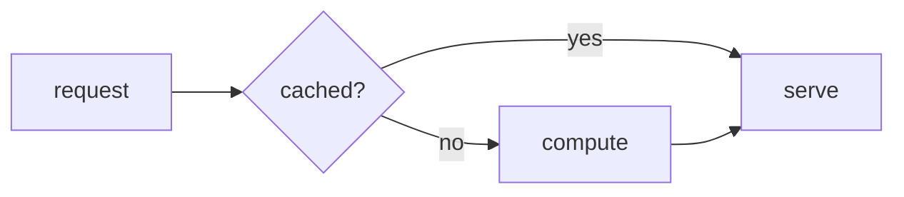

# Benchmark PR body

Use when the PR claims speed, size, memory, cost or query-count wins.

````md
- <what got faster or smaller, in one line with the headline number>
- <why: the mechanism, one bullet>

| Metric | Baseline (`main`) | Candidate (this PR) | Delta |
| --- | --- | --- | --- |
| p50 latency | 412 ms | 188 ms | -54% |
| p95 latency | 1.9 s | 0.7 s | -63% |
| Queries / request | 14 | 7 | -50% |
| Bundle (gzip) | 312 kB | 301 kB | -3.5% |



```ts
// the change that produced the numbers
const rows = await loadOnce(orgId);
```

- Harness: `scripts/bench.ts`, same machine, same data, N runs, median reported
````

Rules:

- Baseline always comes from the target branch, candidate from the PR branch, measured the same way.
- Always a table. Never prose like "about 2x faster".
- Include the unit, the run count and what was held constant.
- If a metric got worse, list it. Do not hide it.
