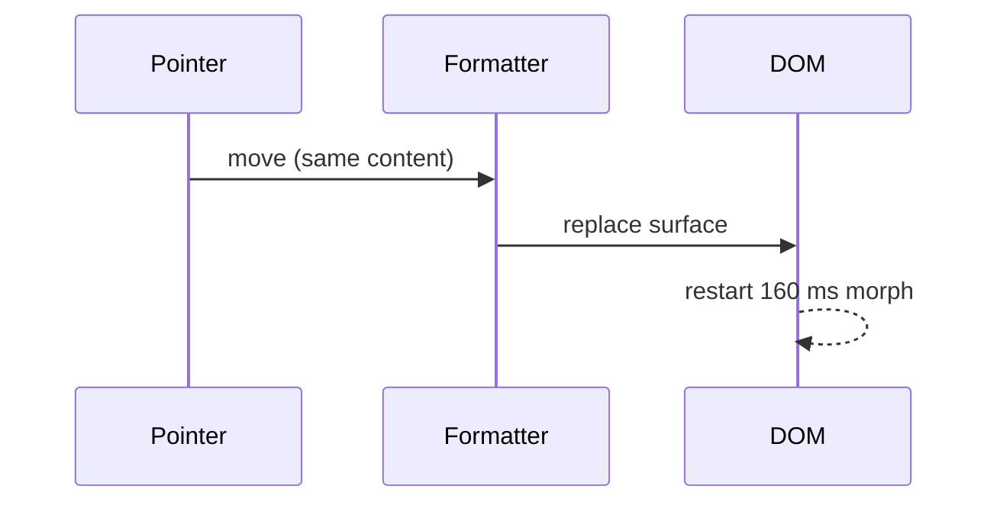

# Technical-blog PR body

Use only for changes that are impressive, difficult, high-risk or wide-scoped. Everything else uses `default.md`.

Voice: first-person plural or neutral, concrete, short paragraphs, every claim backed by a snippet, diagram, table or image. Still no validation talk and no commit history.

````md
## Problem

- <what was broken or missing, with the user-visible symptom>
- <why it mattered, a number if there is one>


## Root cause



```ts
// before
container.innerHTML = html; // every pointer move
```

## Approach

- <decision 1 and the alternative that lost, in one line>
- <decision 2>

```ts
// after
if (html === lastHtml) return container;
```

## Result

| Case | Before (`main`) | After |
| --- | --- | --- |
| ... | ... | ... |

## Risk and rollout

- <blast radius: which surfaces use this>
- <default behavior unchanged / flag / migration>
- <how to revert>

## Follow-ups

- <only things deliberately left out>
````

Rules:

- Tell the story of the final result, not of the iterations.
- Diagrams for flows and state, tables for comparisons, snippets for the core of the fix.
- Link code with refs (`path/to/file.ts:42`).
