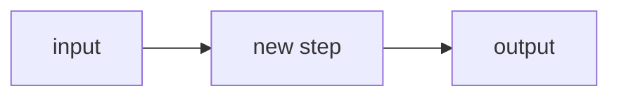

# Default PR body

Title: Conventional Commit, imperative, no scope noise, e.g. `feat(dashboard): add gliding scrub dot to traffic hero`.

````md
- <what changed, one line, user-visible effect first>
- <second most important change>
- <constraint or behavior worth knowing, e.g. default stays the same>



```ts
// usage or internals, the smallest snippet that shows the idea
<EChartsAreaChart.Tooltip maxRows={8} layout="rows" scrub />
```

- Touches `path/to/file.ts:42` (core change)
- Env / migration / follow-ups (only if something must be set or run)
````

Keep:

- 3 to 6 bullets.
- One diagram or one snippet is enough. Both only if both add something.

Drop:

- Test or validation lines.
- History of how the PR got here.
- Restating the diff file by file.
