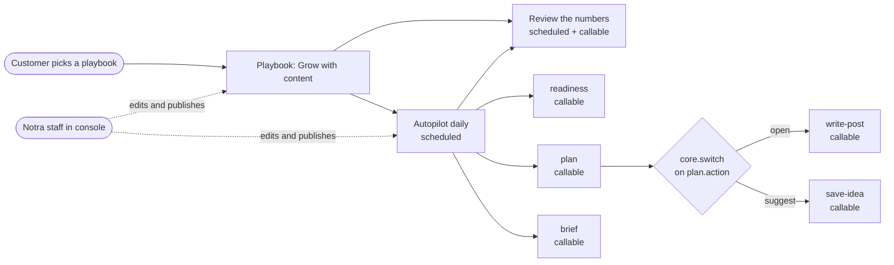
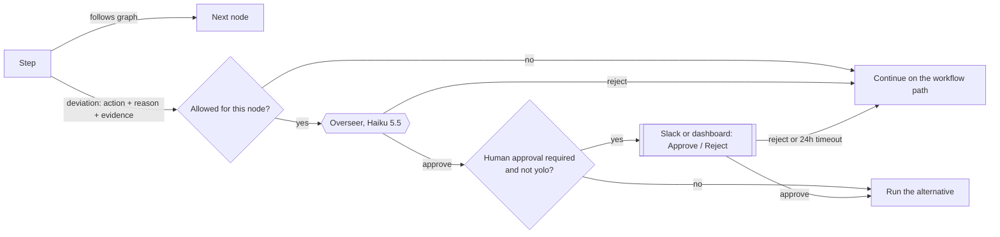

# PRD: Autopilot playbooks on Notra Workflows

Status: Draft v8 · Owner: TBD · Builds on #2045 (workflow graph engine) and #1973 (workflow UI components)

## Problem Statement

Autopilot does useful work every day. It fixes agent readiness, writes posts for content gaps and releases, and sends the team a Slack brief. But it's one hardcoded pipeline that runs once a day. Changing what Autopilot does, adding a step, or giving a job its own cadence means a code change and a deploy. Notra's team can't tune the default behaviour for all customers without engineering. Customers can only turn whole jobs on or off.

On the engineering side, every new capability means editing the pipeline. The item flows (an @notra mention, a merged PR, writing a saved idea) each have their own hand-written workflow. Scheduling is one cron sweep over `autopilot_settings`.

## Solution

Autopilot runs on **Notra Workflows**: stored, versioned graphs of blocks that the #2045 engine executes. Customers never see workflows in this version. They pick a **playbook**, and Notra runs that playbook's workflows in the background. Notra staff edit workflows and playbooks in the admin console (`apps/console`) with the #1973 builder.

Concepts:

- **Block**: a unit of work implemented in code and registered by type, for example `autopilot.write-post`, `core.if` or `core.run-workflow`. Blocks are the only place code lives.
- **Workflow**: a stored graph of blocks, wired together with deterministic if/else and switch nodes. Each workflow is one of three kinds:
  - **Scheduled only**: started by a schedule and nothing else. Example: the master "Autopilot daily".
  - **Callable only**: started only when another workflow calls it. Example: write-post, which only makes sense with a brief from the planner.
  - **Scheduled and callable**: has its own schedule and can also be called by a master. Example: "Review the numbers" runs weekly on its own, and the daily master also calls it before the content workflow.
- **Playbook**: what a customer selects. It has a name and description, the scheduled workflows it runs with their default cadence, and the options it exposes to the customer (for example "Write about releases" on or off).
- **Capability**: a named side effect, such as opening a PR, posting to Slack or writing a post. A workflow can only do what its nodes declare.
- **Deviation**: a step's request to leave the workflow path. The request must explain why, and an overseer has to approve it.

### Determinism and deviations

Autopilot follows its workflow. Branching uses deterministic if/else and switch nodes that read earlier node outputs. There are no model calls in branching. The runtime enforces capabilities in code, not in a prompt: each block's manifest defines the side effects it can have, and a graph can only narrow them. A run can never open a PR, write a post, post to Slack or call a workflow unless the block allows it and the node doesn't turn it off.

A step may still decide the workflow doesn't fit. For example, the plan says "write a post" but an existing page already covers the topic. The step then doesn't act. It files a **deviation request** with the action it wants, the reason and the evidence. A code check runs first: the action must be on that node's deviation allowlist, and the node must have deviations left this run. If the request passes, the **overseer** reviews it. The overseer is a fixed step in the master workflow, run by Claude Haiku 5.5 at temperature 0 with structured output. It returns approve or reject with a reason. It can't act or change the request, and if it errors, the request is rejected.

After the overseer approves, the workspace's **approval policy** may still require a person. The policy is set per capability: `overseer` means the overseer's approval is enough, and `human` means someone has to approve in Slack or in the dashboard queue. PR opening defaults to `human`. **Yolo mode** never asks a person, but it doesn't bypass the capability gate or the overseer.

## User Stories

Customer (workspace admin)

1. As a workspace admin, I want to pick a playbook that describes what Autopilot will do, so that I get a working setup without configuring individual steps.
2. As a workspace admin, I want to switch to a different playbook, so that Autopilot's focus changes from the next run on.
3. As a workspace admin, I want to set the time of day and timezone Autopilot works in, so that the brief arrives when my team starts.
4. As a workspace admin, I want to turn the options my playbook offers on or off (for example release posts), so that I can leave out work I don't want.
5. As a workspace admin, I want to see what Autopilot did, when it last ran and when it runs next, in plain language and without workflow graphs, so that I know it's working.
6. As a workspace admin, I want to choose per action whether an approved deviation also needs a person, with PR opening needing one by default, so that risky changes always get a human look.
7. As a workspace admin, I want a yolo mode where Autopilot never asks anyone, so that it can run unattended. Only admins can switch it, and the brief says when it's on.

Reviewer

8. As a reviewer, I want ideas, pull requests, merges, dismissals and the Slack brief to keep working as they do today, so that the migration changes nothing about how I review.
9. As a reviewer, I want every off-workflow action to come with the step's explanation and the overseer's decision, so that I know why Autopilot left its usual path.
10. As a reviewer, I want to approve or reject a deviation in Slack, or in a dashboard queue with an email when there's no Slack, so that approvals reach me wherever I am.
11. As a reviewer, I want a failed step to show its own error while the rest of the run continues where that's safe, so that one broken readiness scan doesn't cost me the brief.

Billing and limits

12. As a workspace owner, I want credits charged only when Autopilot actually opens a pull request, as today, so that empty runs stay free.
13. As a workspace owner, I want the open-PR limit and the autonomous PR budget to apply across all workflows in my playbook together, so that more workflows don't mean more PRs.
14. As a workspace owner, I want a run that runs out of credits to stop cleanly and say why, so that I'm never charged for half-finished work.

Notra staff (console)

15. As Notra staff, I want to edit a workflow on a canvas with the block palette, if/else and switch nodes, so that I can change Autopilot's behaviour without a deploy.
16. As Notra staff, I want to save a draft and only publish it when it passes validation, so that a broken graph never reaches customers.
17. As Notra staff, I want to test-run a draft workflow or playbook against an internal workspace before publishing, so that I see real output first.
18. As Notra staff, I want every published version kept, with who published it and when, and a one-click rollback, so that I can undo a bad change fast.
19. As Notra staff, I want to create and edit playbooks: their workflows, default cadence and customer options, so that we can offer new setups without engineering.
20. As Notra staff, I want each run's full tree (workflows called, nodes, branches taken, deviations, model inputs and outputs) in the console trace, so that I can debug a decision without database queries.
21. As Notra staff, I want to see which workspaces run which playbook version, so that I know who a change affects.

Notra engineer

22. As a Notra engineer, I want new behaviour to mean a new block plus a console edit, so that the scheduler and runtime never change for a new capability.
23. As a Notra engineer, I want publishing to reject call cycles, too-deep calls, calls to schedule-only workflows, schedules on callable-only workflows, capabilities beyond the block's manifest and references to missing outputs, so that bad graphs fail at publish time and not in production.
24. As a Notra engineer, I want every run pinned to the playbook and workflow versions it started on, so that a publish mid-run doesn't change the graph under it.
25. As a Notra engineer, I want a workflow call to be one durable step from the parent's point of view, so that a parent retry never starts a second child.

## Implementation Decisions

Storage (brings back what #2045 trimmed)

- `workflows`: key, name, description, `started_by` (schedule, call or both), created_by.
- `workflow_versions`: workflow_key, version, graph (jsonb), status (draft or published), published_by, published_at. Published versions are immutable. Each workflow has one draft and its published history.
- `playbooks` and `playbook_versions`: key, name, customer-facing description, and per version a list of entries `{ workflow, cron, enabled }` plus options `{ id, label, description, default, binds: [{ workflow, nodeId, configPath }] }`. An option sets a node config value (for example `enabled` on the write-post call), so options never fork a graph.
- `organization_playbooks`: organization_id, playbook_key, option values, time of day, timezone, enabled. It replaces `jobs`, `briefHour` and `timezone` on `autopilot_settings`. Repository, Slack channel, PR limits, approvals and yolo stay on `autopilot_settings`.
- A playbook entry follows the latest published workflow version by default. A playbook version can pin a workflow version instead.
- The current code-defined `AUTOPILOT_DAILY_WORKFLOW` becomes a seed. A migration script inserts it as version 1, and from then on the database is the source of truth. Blocks stay in code in the registry, and stored graphs only reference block types.

Engine (extends #2045)

- Node kinds grow to match the #1973 components that already exist: `condition` (if/else) and `switch`. New blocks:
  - `core.if`: a rule `{ subject, operator, value }` (the #1973 `WorkflowRule` shape), where subject is a `{{nodes.*}}` or `{{trigger.*}}` reference. Operators: equals, not_equals, gt, gte, lt, lte, contains, exists, in. Ports are `true` and `false`.
  - `core.switch`: ordered cases, each with a rule and a port, plus `otherwise`.
  - Rules are pure functions, with no model calls and no I/O. A reference that doesn't resolve makes the rule false, so it takes `false` or `otherwise`. The exception is `exists`, which simply returns whether the value exists. The node's trace records the reason, for example `No value for nodes.plan.output.outcome`.
- Joins need no block: a node starts once all its incoming edges are settled and at least one was taken, as in #2045.
- `core.run-workflow` with `{ workflow, input }` calls another workflow and waits for its result. WDK 4.8.8 can't durably start a child run and wait for it from inside a workflow, so the child runs inline inside the parent's WDK run. It still gets its own `workflow_runs` row, with id `${parentRunId}_${nodeId}`, unique on `(parent_run_id, parent_node_id)`, so a retried call never starts a second child. Its ports are `out` and `error`, so `onError` applies. When we move to Workflow 5, which can start and await a child from a workflow, we should revisit this.
- Input and output are defined at the workflow level, not as nodes. Call input arrives as `{{trigger.*}}`, and an input schema with defaults sits next to the graph. The defaults also fill a scheduled run of a workflow that is both scheduled and callable. `graph.output` holds references that are resolved when the run succeeds, so there's a single output and no rule needed for which output node wins.
- One running instance per (organization, workflow_key), however it was started. A call that hits a running instance ends on `error` with "already running".
- Every called workflow is resolved and checked when the root starts, and the run keeps those graphs for its whole lifetime. #2045 already does this, with the codes `unknown_workflow`, `not_callable`, `not_schedulable`, `call_cycle`, `call_depth` (at most 3) and `unknown_reference`. Publishing runs the same checks across published versions, plus two more: input references must match the child's schema, and nodes can't widen their block's capabilities. The console save action runs the same validation and shows issues on the nodes.

Capabilities, deviations and approvals

- Side effects go through one gated client keyed by capability name, for example `github.pull_request.open`, `slack.message.post`, `autopilot.idea.save` or `workflow.call`. Capabilities are defined in one place: the block manifest. A node can only narrow them, using an optional `capabilities` subset in the graph, so a console edit can never give a workflow a new side effect. Calling a capability that isn't allowed throws `FatalError`.
- A node can declare `deviations: { allowed: [capability], max: 1 }`. The default is none. v1 ships two: write-post may update an existing page instead, and plan may save an idea instead of opening a PR.
- A step files a deviation by returning `{ status: "deviation", capability, action, reason, evidence }`. The engine checks the allowlist in code, then runs `core.oversee` as its own durable step. The overseer model is pinned in `packages/ai` constants and gated by an `autopilot-overseer` eval. It gets the node's purpose, the request, the evidence and the team's rules.
- Approval policy lives on `autopilot_settings`: `deviationApprovals: Record<capability, "overseer" | "human">` (default: PR opening is human, everything else overseer) and `yolo: boolean`, which is admin-only and records who changed it and when.
- Human approval doesn't wait inside the run. Because only one instance of a workflow can run at a time, an approval left open for a day would block the next daily run. Instead, the node ends `halted` and the request is stored in `workflow_run_deviations` as pending. The run continues and finishes normally.
- The request goes to the Autopilot Slack channel with Approve and Reject buttons. It also appears in a dashboard approval queue, and members who can manage Autopilot get an email through the existing `packages/email`. The first decision wins and the decider is recorded. An approval starts a small separate run that performs the approved action, under the same capability gate, billing and PR limits. A request with no answer within 24 hours expires as rejected.
- Every request, approved or rejected, is stored in `workflow_run_deviations` and logged as a `decision` event. Approved ones run under the same billing and PR limits as normal work.

Runs and scheduling

- `workflow_runs` has `parent_run_id`, `parent_node_id` and `root_run_id` from #2045. Depth isn't stored, because it follows from the parent chain. Storage adds `workflow_version` and `playbook_version`. Children inherit the root's lease.
- `autopilot_runs` stays the customer-facing run row and links to the root workflow run. Findings also record workflow_run_id and node_id.
- The `/api/cron/autopilot` sweep becomes a scheduler over playbook entries. For each enabled `organization_playbooks` row it expands the playbook's crons in the workspace's timezone and time of day, starts due roots, and runs a missed slot once.

Customer UI (dashboard)

- Setup and settings replace "pick automations" with a playbook picker (name, description, what it does on which days). The playbook's options become toggles, and time of day and timezone stay where they are today.
- The run view keeps today's timeline and log (`autopilot_run_events`), grouped by step titles. No canvas, no workflow names or graphs. Deviations show as plain-language entries with both reasons.
- New: the approval queue, the approval policy per action, and the yolo switch.

Admin UI (console)

- New Autopilot sections in `apps/console`: Workflows (list, canvas editor with the #1973 `WorkflowCanvas`, `WorkflowNodePalette` and `WorkflowNodeSheet`, with if/else and switch from the existing components), Playbooks (entries, cadence, options), version history with diff and rollback, and Test run against a chosen internal workspace.
- Run traces gain the run tree on the canvas, with `WorkflowRunTimeline` and `WorkflowRunLog` per node, and the branch taken at each condition.
- The block palette lists registered blocks from the registry manifest, so the console never offers a block the runtime can't run.

## Testing Decisions

- Test external behaviour: given a graph, blocks and inputs, check which nodes ran, the branches taken, the outputs and the run status. Don't test interpreter internals.
- `packages/workflows`: rule operators and unresolved references, if and switch routing, run-workflow (success, child error under each onError, retry doesn't start a second child, "already running"), and publish validation for every rule listed above.
- Dashboard: extend `tests/utils/workflow-graph-runner.ts` to load stored versions and run child graphs. `autopilot-graph.test.ts` checks that the seeded default playbook produces the same findings, PRs and brief as the #2045 graph for the existing scenarios.
- Capabilities and approvals: an undeclared capability fails, an off-allowlist deviation never reaches the overseer, an overseer error rejects, a human-approval deviation halts the node without blocking the run, an approval starts a separate run that performs the action, and an unanswered request expires, and yolo skips people but not the gate. All of these run with a stubbed overseer.
- Versioning: a publish during a run doesn't change it, rollback re-points the playbook, and pinned versions are honoured.
- Scheduler: due selection per playbook entry, timezones and DST, a missed slot running once, overlap with a running root.
- Evals: the new `autopilot-overseer` suite, and `autopilot-planner` re-run to confirm nothing changed.

## Rollout

1. Merge #2045. Besides the engine, it already includes `core.if`, `core.switch`, `core.run-workflow`, `startedBy`, `graph.output` and the run tree, with Autopilot split into `autopilot.daily` → `autopilot.content`. Check that outputs match on internal workspaces behind the `autopilot` flag.
2. Add the storage tables, and seed the code definitions as the "Default" playbook and its workflows. Only the source of the definitions changes: `compileWorkflowBundle` gets them from a database resolver instead of code.
3. Add the one-running-instance rule and the playbook scheduler.
4. Add capabilities, deviations, the overseer and approvals.
5. Ship the console workflow and playbook editor, version history and test runs.
6. Migrate every enabled `autopilot_settings` row to the Default playbook, mapping `jobs` to its options, and ship the customer playbook picker.
7. Publish a second playbook to prove the flow end to end.

## Out of Scope

- Customers seeing, building or editing workflows. Only Notra staff edit, in the console.
- Staged or percentage rollouts of published versions.
- Per-customer forks of a workflow. Customers only change playbook options, time of day and timezone.
- New external services from the #1973 templates (Browserbase, Ahrefs, Firecrawl, Webflow, WordPress, Notion, Gmail). Each one needs the `dpa-check` gate and a listing at `/subprocessors` at least 14 days before it receives customer data.
- Event-triggered workflows. The GitHub item flows stay on their current workflows in v1.
- Fire-and-forget calls, loops, delays, and approval nodes inside graphs. Approval of deviations is in scope.
- Moving the Automation page (schedules, event triggers, GEO alerts) onto the engine.

## Decided

- There are three kinds of workflow: scheduled only, callable only, and both.
- Branching is deterministic (if/else, switch). Leaving the workflow path needs a reason and overseer approval, and capabilities can never be added by a deviation.
- v1 deviations: write-post may update an existing page instead, and plan may save an idea instead.
- Human approval is configurable per capability, with PR opening defaulting to human. Approvals happen in Slack, or in the dashboard queue with email. Yolo mode never asks a person, is admin-only, and is shown in the brief.
- Customers select playbooks and never see workflows. Notra staff edit workflows and playbooks in the console.
- No staged rollouts. A published version goes live for every workspace on that playbook at its next run. Safety comes from validation on publish, test runs on an internal workspace and one-click rollback.

## Open Questions

1. Can customers turn individual workflows in a playbook on or off, or only the options staff chose to expose? This draft assumes options only.
2. Can a workspace run more than one playbook at once, or exactly one?
3. Should customers get a "Run now" for their playbook, as the Autopilot page has today?
4. Who can publish in the console: every Notra staff member, or a smaller group with a second reviewer?
5. Should calls ever be fire-and-forget? This draft recommends adding them together with delays, starting with measuring a post's impact 14 days after merge.
6. Should `autopilot_runs` later be replaced by `workflow_runs`?
